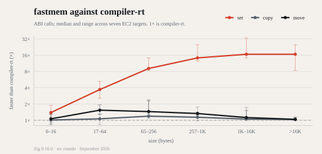

<h1>
  <picture>
    <source media="(prefers-color-scheme: dark)" srcset="docs/static/logo-dark.svg">
    
  </picture>
</h1>

Fast memcpy, memmove, and memset for Zig.

Zig code gets these operations from compiler-rt. compiler-rt's `memset` is a byte loop, and its `memcpy` and `memmove` are slower than glibc on most CPUs. fastmem replaces them with kernels that are tuned per CPU model and measured against glibc and compiler-rt on seven EC2 targets. It imports only `std` and has no libc dependency.

<picture>
  <source media="(prefers-color-scheme: dark)" srcset="docs/static/benchmark-dark.svg">
  
</picture>

## What is in it

- [Kernels](https://baskingspot.dev/fastmem/#kernels): AVX-512 and AVX2 kernels with per-model tuning, Arm Optimized Routines on aarch64, and a generic fallback.
- [Runtime dispatch](https://baskingspot.dev/fastmem/#runtime-dispatch): one x86_64 Linux baseline binary selects AVX-512, AVX2, or generic kernels from CPUID.
- [Correctness](https://baskingspot.dev/fastmem/#correctness): the guard-page suite, the per-model codegen gates, and the export-layer binary checks.
- [Performance](https://baskingspot.dev/fastmem/#performance): the scorecard against glibc and compiler-rt on all seven targets.
- [Limits](https://baskingspot.dev/fastmem/#limits): the export layer is ELF only and needs the LLVM backend; other targets get the generic vector fallback.

## Install

```sh
zig fetch --save https://baskingspot.dev/fastmem/v0.1.1.tar.gz
```

Add the module in `build.zig`:

```zig
const fastmem = b.dependency("fastmem", .{ .target = target, .optimize = optimize });
exe.root_module.addImport("fastmem", fastmem.module("fastmem"));
```

fastmem builds with Zig 0.16 only.

## Documentation

- The [guide](https://baskingspot.dev/fastmem/) covers the kernels, runtime dispatch, correctness, and the measured results.
- The [API reference](https://baskingspot.dev/fastmem/api/) documents every public symbol.
- [`AGENTS.md`](AGENTS.md) has the working notes for the repository.

## Work on it

```sh
just ci
```

`nix develop` provides the toolchain. `just --list` shows the recipes. `just ci` runs what CI runs. `just test-guard` runs the full correctness matrix on this host. The benchmark fleet and its harness live in `baskingspot/infra`; this repository keeps the fastmem adapter.

## License

MIT. See `LICENSE`. The aarch64 kernels are ports of Arm Optimized Routines; `THIRD_PARTY.md` lists every port and its terms. The logo files in `docs/static/` are baskingspot marks and are not covered by it. See `docs/static/LICENSE`.

## How it's made

Built with LLM assistance. [How, in detail](https://github.com/baskingspot/.github/blob/main/docs/AI.md).

<a href="https://github.com/baskingspot"></a>
